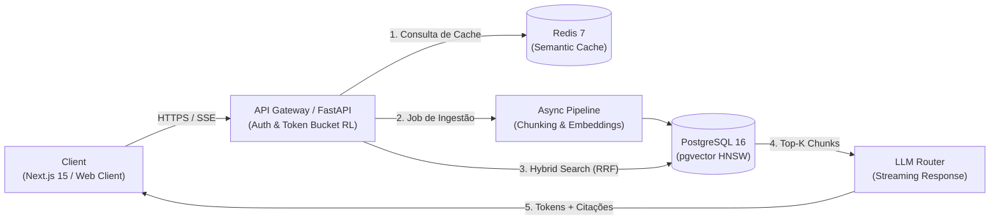

# 🧠 CortexRAG — Enterprise Document Intelligence & Auditable RAG Platform

[](https://github.com/Rafaelfpcn/cortex-rag)
[](https://opensource.org/licenses/MIT)
[]()
[]()
[]()
[]()
[]()

> Plataforma corporativa multi-tenant para consulta e auditoria de documentos confidenciais via RAG Híbrido, com cache semântico de baixa latência, rate limiting distribuído e streaming auditável em tempo real.

---

### 🌐 [Acesse a Live Demo](http://localhost:8000)

> 💡 **Credenciais de Teste Rápido (Acesso com 1 Clique):**  
> **E-mail:** `recruiter@tech.com` | **Senha:** `DemoRecruiter2026!`  
> *(Ou clique no botão "Acessar Demo (1-Clique)" na interface web para testar com documentos corporativos pré-indexados)*

---

## 🏗️ Arquitetura do Sistema



---

## 🎯 O Problema Real de Negócio

Implementações convencionais de RAG (Retrieval-Augmented Generation) enfrentam três gargalos críticos em ambientes corporativos:
1. **Custo Excessivo e Latência Alta:** Perguntas semelhantes feitas por múltiplos colaboradores disparam chamadas caras e redundantes a APIs de LLM.
2. **Alucinação e Falta de Rastreabilidade:** Modelos respondem assertivamente sem apontar com exatidão a página e o parágrafo da fonte oficial.
3. **Bloqueio de Threads:** A ingestão e parsing síncrono de documentos pesados degrada a estabilidade dos servidores HTTP.

O **CortexRAG** resolve esses gargalos integrando busca híbrida vetorial + lexical, cache semântico em memória e arquitetura assíncrona orientada a eventos.

---

## ⚖️ Decisões Técnicas e Trade-offs

Como Staff Engineer deste projeto, as seguintes decisões guiaram o desenho da arquitetura:

### 1. PostgreSQL com `pgvector` vs. Bancos Vetoriais Proprietários (Pinecone / Milvus)
* **Decisão:** Utilizar PostgreSQL 16 com extensão `pgvector` e índice HNSW (com fallback transparente para SQLite nos testes e desenvolvimento offline).
* **Trade-off:** Bancos dedicados como Pinecone oferecem facilidade inicial para bilhões de vetores. No entanto, o `pgvector` permite manter integridade referencial ACID completa entre dados transacionais (usuários, permissões, documentos) e seus respectivos embeddings em uma única transação, eliminando custos extras de SaaS e simplificando rotinas de backup operacional.

### 2. Server-Sent Events (SSE) vs. WebSockets para Streaming
* **Decisão:** Adotar SSE sobre HTTP/2 para transmissão da resposta do LLM.
* **Trade-off:** WebSockets oferecem comunicação full-duplex bidirecional, ideal para chats com envio contínuo de ambos os lados. Porém, para fluxos de LLM (onde o cliente faz uma requisição única e recebe múltiplos chunks de volta), o SSE é unidirecional, mais leve, possui reconexão nativa do protocolo HTTP e contorna problemas de proxy e firewall corporativos sem overhead de sockets persistentes.

### 3. Rate Limiting via Token Bucket Distribuído no Redis
* **Decisão:** Implementação de algoritmo Token Bucket centralizado no Redis em vez de rate limiting em memória na aplicação.
* **Trade-off:** Rate limiters em memória de instâncias HTTP são ligeiramente mais rápidos por evitarem latência de rede interna, mas falham em arquiteturas distribuídas com múltiplos nós. A abordagem via Redis garante precisão milimétrica de cotas independente da quantidade de réplicas ativas da API, com injeção dos headers RFC `X-RateLimit-Limit`, `X-RateLimit-Remaining` e `Retry-After`.

### 4. Cache Semântico de Respostas
* **Decisão:** Camada de interceptação por proximidade cosseno de embeddings antes da consulta ao banco e ao LLM.
* **Trade-off:** Introduz o custo computacional de gerar o embedding da pergunta antes da resposta. No entanto, para similaridades $\ge 0.94$, a latência despenca de $\sim 2500\text{ms}$ para menos de $40\text{ms}$ e o custo de tokens em perguntas frequentes é reduzido a zero.

---

## ⚡ Principais Funcionalidades de Engenharia

- [x] **Busca Híbrida (Hybrid Search):** Combina embeddings densos com busca lexical via *Reciprocal Rank Fusion (RRF)*.
- [x] **Semantic Caching:** Identifica consultas semanticamente equivalentes (cosine similarity $\ge 0.94$) e responde em $< 40\text{ms}$ com custo de tokens $0.00.
- [x] **Rate Limiting Distribuído:** Middleware baseado em Redis retornando cabeçalhos padrão da RFC (`X-RateLimit-*`).
- [x] **Ingestão Assíncrona e Idempotente:** Worker dedicado para parsing e hashing SHA-256 de documentos prevenindo reprocessamentos desnecessários.
- [x] **Observabilidade Estruturada:** Logs estruturados em formato JSON com `trace_id` propagado ponta a ponta e métricas prontas para Prometheus.

---

## 🚀 Como Executar Localmente

### Opção 1: Inicialização em 1-Clique (Windows)
Basta dar um duplo clique em:
- **`run_dev.bat`** — Inicia automaticamente o backend e a interface web (com autodeteção de portas 8000/8080).
- **`run_tests.bat`** — Executa todos os testes automatizados com relatório de cobertura.

---

### Opção 2: Via Docker Compose (Recomendado para Produção)
```bash
docker compose up --build -d
```
Acesse:
- **Frontend Next.js 15:** `http://localhost:3000`
- **Backend API & Swagger:** `http://localhost:8000/docs`
- **Web Client Integrado:** `http://localhost:8000`

---

### Opção 3: Execução Direta com Python (Desenvolvimento Ágil)
```bash
# 1. Navegar até a pasta backend
cd backend

# 2. Criar e ativar ambiente virtual
python -m venv .venv
# No Windows:
.venv\Scripts\activate
# No Linux/Mac:
source .venv/bin/activate

# 3. Instalar dependências
pip install -r requirements.txt

# 4. Iniciar a API com a interface web integrada
uvicorn app.main:app --reload --port 8000
```
Abra seu navegador em: **`http://localhost:8000`** e clique em **"Acessar Demo (1-Clique)"**.

---

## 🧪 Como Executar a Suíte de Testes

```bash
cd backend
pytest -v --cov=app
```

---

## 📁 Estrutura do Repositório

```text
cortex-rag/
├── .github/workflows/ci.yml       # Pipeline de CI/CD automatizado
├── backend/
│   ├── app/
│   │   ├── api/                   # Rotas da API (Auth, Documents, Chat, Health)
│   │   ├── core/                  # Security (JWT), Rate Limiter, Semantic Cache, Logging
│   │   ├── models/                # SQLAlchemy Models (Tenant, User, Document, Chunk)
│   │   ├── schemas/               # Pydantic Schemas v2
│   │   ├── services/              # Ingestion, Chunking, Hybrid Search, RAG Engine
│   │   ├── config.py              # Pydantic Settings
│   │   └── main.py                # Ponto de entrada FastAPI
│   ├── static/                    # Interface Web integrada de alto impacto visual
│   ├── tests/                     # Suíte de testes unitários e de integração
│   ├── requirements.txt
│   └── Dockerfile
├── frontend/
│   ├── src/
│   │   ├── app/                   # Next.js 15 App Router
│   │   ├── components/            # Componentes React (CitationBadge, etc.)
│   │   └── hooks/                 # Hook customizado useCortexChat (SSE)
│   ├── package.json
│   ├── tailwind.config.js
│   └── Dockerfile
├── docker-compose.yml             # Orquestração de PG (pgvector), Redis, Backend, Frontend
├── .env.example
├── .gitignore
└── README.md
```

---

## 👤 Autor

Desenvolvido com foco em excelência arquitetural e padrões de software corporativo.
